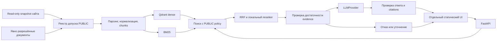

# AI Technical Consultant — поэтапный план и дорожная карта

> Для дальнейшего выполнения: использовать `superpowers:executing-plans`, выполняя задачи последовательно. Документ — проект дорожной карты; продуктовый код в этой итерации не создаётся. Архитектурные рекомендации ниже ещё не являются согласованными решениями.

**Цель:** отдельный публичный технический консультант для инженеров и заказчиков МНПП «Сатурн», отвечающий только по разрешённым материалам с источниками и отказом при нехватке доказательств.

**Архитектура:** статический самостоятельный интерфейс Astro/TypeScript → FastAPI → policy → hybrid retrieval → локальный reranker → evidence gate → сменный LLMProvider → проверка ответа и citations. Qdrant, embeddings и corpus независимы от генеративной модели.

**Стек (предложение):** Python 3.12+, FastAPI/Pydantic, Qdrant, локальные multilingual embeddings и reranker, BM25, Astro/TypeScript, Docker Compose; pytest и отдельный evaluation runner. Версии библиотек зафиксировать lockfiles при реализации, после проверки совместимости.

**Основание:** [исходное ТЗ](../../requirements/original-brief.ru.md), [проверка сайта](../../discovery/2026-11-03-site-audit.md). Последние указания владельца приоритетны: AI отдельно; сайт только read-only; сейчас — план и roadmap, без начала реализации.

## Обязательные ограничения

- Не менять `UkWood/Saturn-Main-Site`, его CI, адреса и assets. Все файлы AI находятся в `LLM-RAG-chat-bot`.
- Сайт остаётся HTML + JS + CSS; отказ AI не влияет на обычные страницы.
- Сейчас отдельный UI; встраивание в сайт — отдельная будущая задача владельца сайта.
- PUBLIC только по явному реестру допуска; неизвестный visibility закрывает доступ. INTERNAL не реализуется.
- Внешнему провайдеру нельзя отправлять исходный код, INTERNAL, credentials, персональные данные или служебные документы. Это относится также к сообщению пользователя и истории диалога, а не только к evidence.
- Qdrant и model services доступны только во внутренней сети; API keys только на backend.
- Без evidence — отказ, без обращения к общим знаниям модели. Замена LLM не меняет индекс и frontend.
- Обычные dev/CI проверки без GPU, ключей и больших моделей. Реальные модели — отдельный профиль тестирования.
- Никаких сроков в календарных датах до измерения корпуса и CPU. Оценки ниже предварительные.

## Варианты реализации

1. **Рекомендуемый:** Qdrant dense + независимый BM25 по тому же snapshot; RRF объединяет ранги, затем локальный reranker. Прозрачно для точных обозначений, легко сравнить варианты. Цена — согласованная публикация двух индексов.
2. **Альтернатива:** dense + sparse/lexical в Qdrant. Меньше отдельных индексов в эксплуатации; требуется доказать качество русского языка и технических токенов, проверить актуальные возможности и лицензии выбранного sparse-подхода.
3. **Managed RAG:** уменьшает эксплуатационные задачи, но расходится с локальными embeddings/KB и будущей миграцией. Не рекомендуется для заданных требований.

Выбор 1 — инженерная рекомендация для прототипа; финальное решение после небольшого retrieval benchmark, до большого индексирования. Большой agent framework не нужен.

## Поток данных и доверие



Индексатор не запускается по пользовательскому URL из чата. Внешняя LLM получает только вопрос после privacy-проверки и разрешённые evidence. Документы и история разговора — данные, не инструкции. При неясной privacy-классификации — блокировка облачной отправки или запрос безопасной переформулировки. Одни регулярные выражения не гарантируют выявление любых персональных данных; границу публичного сервиса и остаточный риск зафиксировать до cloud pilot.

### Контракты, которые нужно утвердить в Phase 0

- `SourceRecord`: source_id, entity_id/type, title, canonical_url, document_type, language, version/date, source_commit, content_hash, visibility, approval/status/provenance.
- `Chunk`: chunk_id, document_id/source_id, text, heading_path, PDF page_start/page_end, entity_ids, metadata, snapshot_id, embedding_model/revision, chunker_version. Страницы PDF — реальные страницы файла, не придуманные моделью номера печатных страниц.
- `Evidence`: chunk_id, ranks/scores, source_id, snapshot_id; confidence — набор измеряемых признаков, не «вероятность истинности» из similarity.
- `AnswerResult`: answer, sources, status (answered/refused/clarification/error), grounding, conversation_id, request_id, reason_code. Ссылки строит backend из реестра.
- `LLMProvider.generate(request) -> result`, `LLMProvider.stream(request) -> events`; provider не владеет retrieval/KB. Base URL/model/key/timeouts — конфигурация. Отдельные capability flags и policy облачный/локальный.
- `POST /api/chat`: message + необязательный conversation_id; сервер владеет историей с TTL, лимитом и изоляцией сессий. Повторный ход проходит новый retrieval; предыдущий ответ не становится источником.
- Streaming: status → provisional delta (если разрешено политикой) → validated answer/sources или refusal/error → done. Для первого безопасного MVP валидировать полный ответ до выдачи текста; настоящий token streaming включить после определения обработки неподтверждённых утверждений.

Смена генеративной модели не требует переиндексации. Смена embedding-модели или chunker требует нового индекса и evaluation. Для preview и production хранить стабильные source IDs, а отображаемые ссылки собирать из конфигурации origins/base; не переписывать старые адреса сайта.

## План структуры проекта (все пути внутри AI-репозитория)

```text
backend/pyproject.toml, backend/uv.lock
backend/src/saturn_ai/
  api/                 # схемы, chat, health/readiness, SSE
  application/         # оркестрация и диалоги
  domain/              # source/chunk/evidence/answer контракты
  policy/              # visibility, privacy, разрешённые назначения
  ingestion/           # адаптер сайта, PDF, chunking, manifests
  retrieval/           # dense, lexical, fusion, reranking
  knowledge/           # registry, snapshots, repositories
  providers/           # fake и OpenAI-compatible
  models/              # embedding и reranker adapters
  observability/       # метрики и безопасные логи
  config.py
backend/tests/{unit,integration,contract}/
evaluation/{datasets,reports}/
fixtures/public-sample/
frontend/              # отдельный Astro UI и будущий переносимый JS клиент
infra/compose.yaml
infra/                  # proxy, deployment, backup/runbooks
config/                 # примеры без секретов, реестр разрешённых источников
```

Не создавать всю структуру заранее: каждый файл появляется с конкретной задачей и проверкой. Corpus/models/индексы и секреты не коммитить. Sample corpus — небольшой, с явным происхождением и допуском.

## Дорожная карта

Каждый этап: тест, демонстрирующий отсутствие поведения → минимальная реализация → проверка → небольшой commit. Названия тестов и команд ниже — целевые команды будущего проекта, сейчас они не выполнялись. Этап не зависит скрыто от будущих: внешние зависимости заменяются явными fake/fixture adapters.

| Этап | Результат и зависимости | Автоматический критерий готовности | Ручная проверка |
|---|---|---|---|
| 0. Discovery и дизайн | Этот аудит; далее ADR, threat model, утверждение контрактов и PUBLIC sample manifest | Проверка manifests/ссылок и соответствия ТЗ; список рисков и решений | Владелец проверяет границы PUBLIC и критерии MVP |
| 1. Минимальный вертикальный RAG | Контракты + parser небольшого корпуса + in-memory index + FakeLLMProvider + refusal/citations; зависит только от 0 | `tests/integration/test_vertical_slice.py`: найденный факт с source ID, поиск документа, отказ без evidence, вымышленная модель, injection, INTERNAL не достигает fake provider | CLI: один подтверждённый ответ и один отказ; без GPU/сети/ключа |
| 2. Ingestion сайта и PDF | Read-only adapter, реестр разрешений, нормализация entities/relations, PDF pages, таблицы; зависит от 1 | `tests/unit/ingestion/`: draft/неразрешённое исключено, software/category mapping, повторный импорт идемпотентен, PDF page, units/таблицы, дубликаты, ошибки parser | Выбрать карточку и разрешённый PDF, сверить chunks и номера страниц с оригиналом |
| 3. Индексы и модели | Qdrant + local embeddings + BM25, atomic snapshot publish; зависит от 2 | `tests/integration/test_index_snapshot.py`: upsert/delete, одинаковый snapshot обоих индексов, восстановление старого, visibility filters | Индексация sample, удаление источника, проверка исчезновения в обоих индексах |
| 4. Retrieval/reranking | Entity lookup, dense+lexical RRF, reranker; зависит от 3 | `evaluation --stage retrieval`: Recall@k/MRR/nDCG; точные/ошибочные артикулы, сравнения, multi-doc, category и obsolete | Показать кандидатов/ранги для контрольных инженерных вопросов |
| 5. Grounded pipeline | Evidence evaluation, refusal, citation validation; зависит от 4, fake provider остаётся достаточным | `tests/unit/grounding/`: неизвестный source ID, неверная страница, конфликт фактов, injection, несуществующее изделие, отсутствие ответа; фиктивные ссылки блокируются | Проверить каждое техническое утверждение по показанным evidence |
| 6. Qwen Cloud | OpenAI-compatible adapter и policy; зависит от 5 | Mock HTTP: timeout/429/5xx, bounded retry, circuit breaker, cancellation, неверный ответ; отдельный real smoke с PUBLIC sample | Проверить официальный endpoint/model/region, сделать один разрешённый запрос; секрет не виден в frontend/logs |
| 7. Стабилизация evaluation | Расширение раннего набора до 200–300 экспертных вопросов; зависит от 4–6 | Версионированный dataset: expected sources/facts, must_answer/must_refuse/tags; held-out split, отчёт provider/corpus/config revisions, quality regression gate | Экспертная сверка сложных ответов и ложных отказов |
| 8. Chat API | HTTP контракт, сессии/TTL, лимиты, ошибки, SSE/cancel; зависит от 5; fake режим не требует 6 | `tests/contract/test_chat.py`: изоляция диалогов, follow-up retrieval, replay/expiry, disconnect, schema, provisional/final events | Диалог в несколько ходов, отмена и восстановление после ошибки |
| 9. Отдельный frontend | Статический Astro UI + TS API client; зависит от 8 | Build/typecheck + browser tests: mobile/desktop, sources, отказ, loading, abort, XSS, недоступный API | Открыть отдельную страницу, отключить API; UI объясняет недоступность, статическая страница доступна |
| 10. Эксплуатационная защита | Усиление ранней security/observability; зависит от 6,8,9 | Rate/body/concurrency limits, CORS, egress/SSRF и parser isolation tests, redaction logs, load profile | Проверить закрытость Qdrant/models, ограничения бюджета, dashboards и аварийный режим |
| 11. CPU production pilot | Linux 32–64 GB + NVMe, Compose, HTTPS proxy, backups/rollback; зависит от 7,10 | Real integration, smoke после deploy, backup/restore, rollback corpus и app; latency/resource/load отчёт | Серверный runbook: запуск, обновление, отказ LLM, восстановление |
| 12. Local LLM migration | llama.cpp/OpenAI-compatible backend; зависит от 7,11 и доступного hardware | Один dataset и те же API tests для cloud/local; hash индекса неизменен, проверка cloud egress off; смена конфигурации без изменения RAG/frontend | Переключить provider и повторить ответы/отказы/citations; сравнить качество и latency |

Security и evaluation начинаются в 0–1, этапы 7 и 10 их расширяют. Реальная проверка embeddings/reranker обязательна перед пилотом; deterministic embeddings доказывают корректность кода, но не качество поиска.

### Ближайшие задачи первого milestone

- [ ] Phase 0: сформировать design document и ADR по retrieval, идентичности источников, privacy, API и отказам; определить разрешённый sample.
- [ ] Создать `backend/tests/integration/test_vertical_slice.py` и фикстуры: подтверждённая характеристика, поиск руководства, вопрос без ответа, правдоподобное несуществующее изделие, вредоносный текст документа.
- [ ] Запустить тест и убедиться в ожидаемом FAIL из-за отсутствующей реализации.
- [ ] Ввести domain-контракты и `FakeLLMProvider`; минимальный `answer(question, corpus) -> AnswerResult` в application; разрешённый parser/поиск и проверку citations. Fake provider записывает полученный context для проверки утечек.
- [ ] `uv run --project backend pytest backend/tests/integration/test_vertical_slice.py -v`: все перечисленные сценарии действительно исполнены и PASS.
- [ ] Ручная CLI-демонстрация ответа с источником и отказа; сохранить фактический отчёт проверки, сделать отдельный commit. Никакого frontend, облачного ключа или скачивания LLM для этого milestone.

### Модели и retrieval benchmark

BGE-M3 — исходный кандидат, не окончательный выбор. Сравнить с multilingual-e5-large и доступной на момент реализации multilingual Qwen embedding-моделью по официальным model cards: русский технический retrieval, лицензия, размер, RAM, CPU p50/p95 и скорость индексации. Сравнить локальный BGE multilingual reranker с более лёгкой multilingual cross-encoder альтернативой. Зафиксировать revisions, pooling/query prefix, длину контекста и метрики. Не переносить решение только по популярности модели.

Технические обозначения хранить и в исходной форме, и в нормализованном поисковом представлении. Не сливать автоматически разные модели из-за замены кириллицы/латиницы. Для опечатки предлагать уточнение, если неоднозначно. RRF объединяет ранги, не складывает несопоставимые raw scores; точный entity match повышает приоритет, но не доказывает ответ на вопрос. Relationship expansion ограничить и явно маркировать; связь «в составе системы» не означает совместимость с любым устройством.

### Quality gates

- Первоначально собрать 30–50 экспертно размеченных вопросов; затем 200–300. Отдельно calibration и held-out; пороги evidence подбирать только на calibration.
- Измерять retrieval Recall@k/MRR/nDCG, supported-fact precision, citation validity/coverage, корректные и ложные отказы, утечки, latency, токены и стоимость.
- Невалидные source IDs/URL и обнаруженная отправка INTERNAL — нулевая допустимость в тестовом наборе. Это критерий блокировки релиза, не обещание абсолютной безопасности модели.
- Целевые значения полноты, качества и p95 утвердить после baseline и замера CPU. До этого нельзя объявлять production readiness по произвольной similarity-константе.
- Противоречивые документы: версия/дата/provenance видны; не выбирать «истину» молча. Для неполного вопроса — уточнение, для неподтверждённых характеристик — отказ.

### Ingestion и эксплуатация

Загрузка документов только по allowlist hosts + paths и явному manifest, с повторной проверкой redirect destinations, защитой от SSRF/path traversal, лимитом размера/времени и изолированным parser. Не выполнять вложения/JavaScript. Архивы, firmware и бинарное ПО не извлекать как текст автоматически. Для сканов OCR — отдельный оценённый профиль с предупреждением о качестве.

Corpus, registry, lexical index и Qdrant collection публиковать как единый immutable snapshot; при неполной сборке остаётся предыдущий. Удаление/отзыв допуска источника инвалидирует retrieval и caches; аварийный denylist действует до переиндексации. Индексация — отдельный job, не HTTP request чата.

Настройки: `LLM_PROVIDER`, `LLM_BASE_URL`, `LLM_MODEL`, `LLM_API_KEY`, provider trust/capabilities, timeout/retry/budget; embeddings/reranker revisions; Qdrant URL; origins/base для страниц и assets; CORS, conversation TTL и logging retention. `.env.example` без секретов, `.env` игнорируется. Не обещать поддержку неизвестного провайдера без contract tests.

Логи: request ID, snapshot/provider/model, retrieval IDs/scores, latency и usage/refusal reason; по умолчанию без сырых вопросов, диалогов и текстов документов. История сессий ограничена сроком жизни и объёмом; нельзя получить чужую историю по перебору conversation_id. Fallback в MVP выключен; будущий cloud fallback запрещён для непубличного контекста.

## Milestones и предварительная оценка

| Milestone | Этапы | Что можно принять | Оценка чистой инженерной работы |
|---|---|---|---|
| M0 | 0 | Аудит + согласованный дизайн и sample policy | 2–4 дня |
| M1 | 1 | Вертикальный RAG с fake provider, источниками и отказом | 2–4 дня |
| M2 | 2–5 | Поиск и grounding на реальном разрешённом корпусе | 8–15 дней |
| M3 | 6–8 | Cloud provider + измеряемое качество + Chat API | 5–9 дней |
| M4 | 9–11 | Отдельный UI и защищённый CPU pilot | 6–10 дней |
| M5 | 12 | Проверяемая смена Cloud → Local | 3–6 дней после готовности hardware |

Ориентир до CPU pilot: 23–42 рабочих дня одного инженера при доступных данных и обратной связи. Это оценка, не обещание срока. Не включает ожидание допуска документов/ключей, экспертную разметку 200–300 вопросов, сложный OCR и закупку сервера. После M1/M2 пересчитать по фактическим результатам. До утверждения дизайна исполнения этапов не начинать.

## Что потребуется от владельца по мере продвижения

1. До ingestion: утвердить PUBLIC sample и кто проверяет актуальность технических фактов. Одного наличия файла на GitHub недостаточно.
2. До Cloud smoke: выбрать доступный регион Model Studio и предоставить ключ через защищённые настройки; секреты не передавать в чат. Проверить обработку пользовательских данных и условия провайдера.
3. До пилота: CPU/RAM/диск, схема сети, hostname/TLS, ожидаемая нагрузка и хранение диалогов. Точный адрес будущего сайта не нужен для разработки ядра.
4. До Local migration: доступное оборудование и допустимая задержка; сравнение моделей на одном evaluation наборе.

## Статус этой итерации

Выполнено: чтение ТЗ, read-only discovery по конкретному commit сайта, создание аудита и проекта roadmap. Не выполнялись: установка продуктовых зависимостей, разработка backend/UI, запросы Qwen, индексация PDF, тесты качества и deployment. Официальные API/model docs требуется проверить непосредственно перед соответствующими этапами; текущий документ не утверждает актуальность конкретного endpoint, региона, цены или модели.


## Обновление 2026-11-03: следующий шаг Phase 0

Подготовлены [design document](../specs/2026-11-03-ai-consultant-design.md), [ADR-0001](../../decisions/0001-rag-boundaries.md), [правила допуска](../../public-source-policy.md) и [реестр кандидатов](../../../config/knowledge/public-sources.json).

Проверены ссылки документов, 8 уникальных pending source IDs, отсутствие неявных разрешений, 4 SHA-256 Markdown по pinned commit и отсутствие изменений в read-only копии сайта. PDF не загружались. Независимый builder check не выявил важных вопросов, препятствующих планированию.

Phase 0 ещё не помечен полностью завершённым: требуется принятие архитектуры и допуск реального sample ответственным владельцем. Пока разрешений нет, M1 может использовать отдельный синтетический offline corpus и FakeLLMProvider. Исполняемый registry validator, backend и API пока не создавались; проверки документов не являются тестами приложения.
