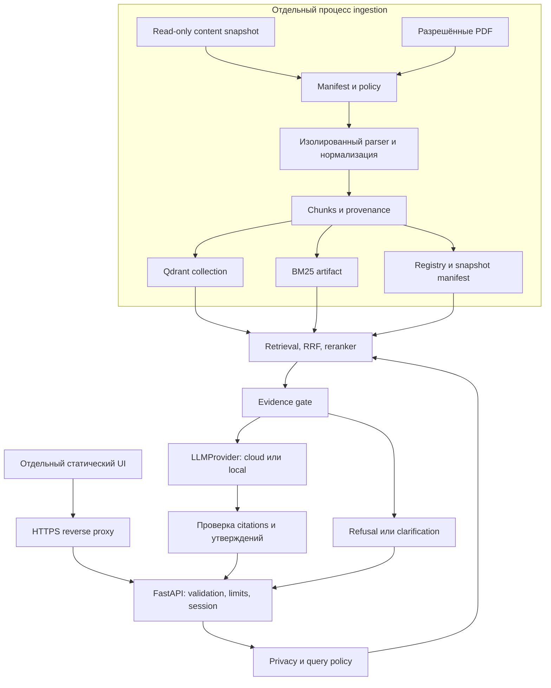

# AI Technical Consultant — архитектура v0.1

Дата: 2026-11-03. Статус: подготовлен для проверки владельцем; реализация ещё не начата.

Основание: [ТЗ](../../requirements/original-brief.ru.md), [discovery](../../discovery/2026-11-03-site-audit.md), [roadmap](../plans/2026-11-03-ai-consultant-roadmap.md), [ADR-0001](../../decisions/0001-rag-boundaries.md). Машиночитаемый [реестр кандидатов](../../../config/knowledge/public-sources.json) описан в [правилах допуска](../../public-source-policy.md).

## 1. Назначение, границы, успех

Публичный консультант помогает инженеру найти документацию, характеристики, состав систем и подтверждённые варианты применения продукции Сатурна. Он отвечает по разрешённым источникам, показывает ссылки и отказывается при нехватке evidence. Приоритеты: достоверность, конфиденциальность, поиск, источники, сменность LLM, простота, UX, скорость и стоимость.

Отдельный проект `UkWood/LLM-RAG-chat-bot`; отдельный UI. `Saturn-Main-Site` используется только для чтения. Никаких правок его файлов, сборки, CI, URL и assets. Будущий widget поставляется из AI-проекта как артефакт; интеграцию в сайт выполняет его владелец отдельной задачей. Статический сайт работает независимо от API.

Не входят в v1: INTERNAL chatbot, fine-tuning, автономные агенты/действия, создание заказов, загрузка произвольных пользовательских документов, автоматический cloud fallback, окончательный дизайн сайта. Нельзя рекомендовать совместимость или характеристики из общих знаний модели. Технический консультант не заменяет проверку проектной документации инженером.

Успех M1: CPU/offline CLI на небольшом разрешённом или синтетическом корпусе выдаёт подтверждённый ответ и citations, корректно отказывает и не раскрывает закрытые данные fake provider. Успех пилота: quality gates на реальном корпусе, защищённый API/UI, измеренная CPU-производительность и проверенное восстановление. Наличие FakeLLMProvider само по себе не доказывает качество реальной LLM.

## 2. Варианты и выбранное для проектирования направление

Рекомендация инженера: Qdrant dense + отдельный BM25 + RRF + локальный reranker. Это позволяет независимо измерять lexical/vector вклад на русских обозначениях. Цена — согласованность двух индексов; решается единым snapshot pointer.

Альтернатива: dense+sparse в Qdrant уменьшает число индексных артефактов. Проверить качество русского lexical-поиска и доступные официальные API перед решением о переходе. Managed RAG не выбран: противоречит независимой локальной KB/embeddings и миграции на local inference. LangChain/LlamaIndex не обязательны; слои соединяются небольшими типизированными адаптерами.

Это направление из roadmap используется как рабочее предложение, а не как ранее полученное одобрение владельца. Окончательный выбор embeddings/reranker требует benchmark; Qwen model/endpoint/region не фиксируются здесь.

## 3. Компоненты и границы доверия

API: HTTP schemas, session ownership, body/rate limits, cancellation. Application: последовательность поиска/ответа, без provider-specific HTTP. Knowledge: registry, активный snapshot, revocation. Retrieval: query normalization, entity lookup, dense/lexical/fusion. Models: локальные embedding/reranker adapters. Providers: generate/stream и capability metadata. Policy: допуск источников, назначения egress, privacy. Observability: IDs, метрики, безопасные события.

Provider не может сам искать документы, читать файлы, выбирать URL для загрузки или выполнять инструменты. UI не имеет доступа к Qdrant/model services, ключам и конфигурации провайдера.

## 4. Модель данных

Все контракты versioned, Pydantic со строгими enum/ограничениями; даты ISO 8601 UTC, текст UTF-8. Идентификаторы не содержат секретов. Поле visibility без значения не получает PUBLIC по умолчанию.

| Контракт | Обязательные поля и правила |
|---|---|
| SourceRecord | source_id (стабильный UUID/ключ реестра), locator, source_revision, approved_content_sha256, title, canonical_path или asset URL, document_type, language, visibility (PUBLIC/INTERNAL/UNKNOWN), approval_state (pending/approved/revoked), approval_id, entity_ids, source_kind |
| SourceRevision | document_id = конкретная версия source, content_sha256, parser_version, fetched_at, document_version/date (nullable), source_commit для Git, publication_verified, provenance. Дата загрузки не подменяет дату документа |
| Entity | namespace/id, type Device/Software/System/Category/Group/Solution/Article/News/Page, title, original designation, curated aliases, status/notice |
| Relationship | from/to entity_id, type, provenance source_id/field path; явно заданная или вычисленная обратная связь; не выводить совместимость из общей системы |
| Chunk | chunk_id, document_id, source_id, snapshot_id, text, heading_path, page_start/page_end (nullable для non-PDF), entity_ids, language, visibility, text_hash, chunker_version |
| Evidence | chunk + dense/lexical rank, RRF score, reranker score, policy_revision; raw scores не являются вероятностями |
| Claim | text + evidence_chunk_ids; каждое техническое предложение должно иметь подтверждающий фрагмент; несовпадающие ID запрещены |
| AnswerResult | schema_version, status, answer, sources, grounding, conversation_id, request_id, reason_code; при отказе sources пусты, answer — безопасное объяснение |

Qdrant point UUID детерминированно строится из document revision + chunk identity; payload содержит chunk text, source/document/snapshot IDs, visibility, entity_ids, section, pages, document_type, даты/версии и нормализованные metadata. Параметры embedding (model revision, dimensions, normalization) принадлежат snapshot manifest. Векторная размерность не захардкожена.

source_id переживает смену hostname; document_id меняется при изменении содержимого; chunk_id — при изменении текста/границ. Полный хеш исходника используется для допуска, хеш извлечённого текста — для дедупликации. У одного PDF могут быть несколько владельцев-изделий; их связи сохраняются. Совпадение содержимого не объединяет разрешения разных источников автоматически.

## 5. Допуск PUBLIC и ingestion

Действующий реестр содержит только кандидатов с `visibility=UNKNOWN`, `approval_state=pending`, `cloud_allowed=false`. Это полноценное безопасное начальное состояние: ни один источник не разрешён автоматически. Публичный URL, отсутствие draft и комментарий модели сайта «всё публично» не заменяют допуск конкретной версии для AI.

Условие допуска: approved + PUBLIC + совпадает hash/commit + подтверждена публикация + источник не в denylist + разрешён конкретный формат/locator. Cloud добавляет cloud_allowed и outbound privacy policy. Фактические поля approvals заполняет ответственный владелец; агент не выдумывает подпись/время одобрения. Будущие схемы документов с INTERNAL отклоняются публичным ingestion и API независимо от выбора локальной LLM.

1. Получить неизменяемый read-only snapshot по commit либо явно разрешённые bytes документа. Не включать scripts/docs/Old_Site/SQL в KB.
2. Проверить manifest и hash до parsing. Для ссылок из карточек создать отдельный candidate; не наследовать approval карточки на PDF.
3. Проверить `draft`, реальный маршрут страницы, publication и visibility. Из frontmatter извлекать только content-поля; не отправлять исходный Markdown/YAML/code во внешнюю LLM.
4. Нормализовать сущности по реальной схеме Astro: software — products выбранной группы; systems.kind=category — Category. Преобразовать specs в доказательные строки с именем, значением, единицей и исходным field path.
5. Сегментировать по heading/абзацам/спискам; таблицу с заголовками и единицами не разрывать без повторения контекста. PDF — сохранять физические страницы, предупреждать о дефектах извлечения; OCR только отдельным профилем.
6. Локально вычислить embeddings; собрать BM25 по тому же набору chunks. Дедупликация не теряет citations/provenance.
7. Проверить counts/hashes/relations/visibility, выполнить retrieval smoke и опубликовать snapshot атомарным pointer; неполная сборка не активируется.

PDF downloader: только разрешённые HTTPS hosts и конкретные paths; запрет credentials в URL, private/link-local/loopback addresses, path traversal и redirect в непроверенное назначение; DNS/redirect revalidation и сетевой egress-контроль. Лимиты размера/страниц/времени, sandbox parser без сети, запрет JS/вложений/исполнения бинарников. Ошибки и некачественные таблицы — quarantine, не молчаливый частичный успех. Нужные legacy HTTP URLs требуют отдельно документированного решения о доверенной загрузке, а не отключения TLS.

При обновлении источника approval не переносится автоматически на новый hash. Отзыв вступает в силу через централизованный denylist до retrieval, перед вызовом LLM и перед выдачей результата/cached answer. In-flight облачный запрос уже нельзя «отправить обратно»; revocation блокирует дальнейшие вызовы и выдачу, это ограничение явно журналируется.

## 6. Retrieval, embeddings, reranking

Локально: исходная и нормализованная формы обозначений, словари сайта и curated aliases. Разные устройства не сливать из-за похожего артикула или кириллицы/латиницы. Неразрешённый неоднозначный артикул → clarification. Статус obsolete/discontinued передаётся в evidence и виден в ответе.

Рабочая схема: entity lookup → dense top 40 + BM25 top 40 с PUBLIC/policy filters → RRF `sum(1/(60+rank))`, rank начинается с 1 → до 30 уникальных кандидатов → локальный reranker → 5–10 evidence chunks в token budget. Числа — начальные настройки эксперимента, не откалиброванные пороги надёжности. Политика допуска применяется к обоим каналам до fusion; связь с системами добавляет только разрешённые соседние chunks в общий лимит, максимум один переход.

BGE-M3 — baseline-кандидат. Сравнить с multilingual-e5-large и актуальным multilingual Qwen embedding по официальным model cards и реальному русскому sample. Для reranker — BGE multilingual cross-encoder и более лёгкий multilingual аналог. Фиксировать license, revision, query/passage formatting, RAM, CPU p50/p95, indexing throughput и Recall@k/MRR/nDCG. До benchmark модель не объявляется production-выбором. CI deterministic embeddings не участвуют в оценке качества реального поиска.

## 7. Evidence gate, генерация, отказ и citations

Gate оценивает наличие нужной сущности, покрытие аспектов вопроса, явные характеристики/ограничения, lexical/entity match, reranker signal, противоречия, версии и число независимых источников. Два дубликата не считаются независимыми доказательствами. Модель не выбирает сама, достаточно ли ей знаний.

Пороги калибруются на отдельной выборке. До калибровки production mode закрыт; M1 допускает только детерминированные сценарии fixture. Gate возвращает sufficient/insufficient/ambiguous/conflict. Недостаточно — refused; неоднозначность — clarification; конфликт — сообщение об обнаруженном расхождении с проверенными ссылками, без произвольного выбора значения. Отказ не вызывает LLM.

Контекст: системные правила + проверенный вопрос + evidence в явно размеченных блоках + разрешённые source/chunk IDs. Документные инструкции недоверенные. LLM возвращает structured claims с chunk IDs; приложение проверяет структуру, принадлежность ID текущему evidence, pages и policy. Заголовки/URL генерирует только backend из registry; raw model URLs не показываются. При непрохождении проверки — refused с reason `unverified_answer`, не автоматическое дополнение фактов.

В M1 ответы формирует FakeLLMProvider по fixtures. В реальном MVP проверка IDs обязательна, но недостаточна: ложное утверждение может ссылаться на реальный chunk. Для точных характеристик применять детерминированную сверку значений/единиц; для свободного текста нужен отдельный проверяемый claim-support evaluator и экспертный quality gate. Нельзя объявлять такую проверку абсолютной защитой от галлюцинаций. До успешной оценки свободных консультаций ограничить допустимые intents проверяемыми facts/document lookup.

Refusal reasons: no_evidence, unknown_entity, conflicting_evidence, privacy_blocked, source_revoked, unverified_answer. Ошибки инфраструктуры имеют status=error, не маскируются под «в базе нет информации». Уточнение не добавляет фактов о продукции.

## 8. LLMProvider и Cloud → Local

Интерфейсы: `generate(GenerationRequest) -> GenerationResult`; необязательный `stream(GenerationRequest) -> AsyncIterator[ProviderEvent]`; `capabilities -> ProviderCapabilities`. GenerationRequest содержит сообщения, evidence IDs, max_output_tokens, timeout/cancellation, schema. Result — текст/claims, usage nullable, finish_reason и model identity. Errors нормализованы: timeout, rate_limited, unavailable, invalid_response, cancelled. Provider не принимает raw user-supplied base_url/model.

Конфигурация: provider kind, base URL, model, secret reference, cloud/local trust, timeouts, retries, context/output budget, capabilities. Ключ не передаётся UI. Только проверенный OpenAI-compatible endpoint; отсутствие structured output не ломает API: adapter использует JSON parsing + validation и закрывает ответ при ошибке. Особенности Qwen thinking/usage/stream проверять по текущей официальной документации, не переносить в application.

Перед cloud интеграцией проверить официальные Alibaba Model Studio docs: регион/endpoint, доступные Qwen модели, формат API, ограничения, стоимость, retention и обработку данных. Модель Flash — кандидат. В этой фазе ключ не требуется и внешние вызовы не выполняются.

Для миграции поднять local OpenAI-compatible server, изменить конфигурацию provider/capabilities, отключить cloud egress, прогнать тот же evaluation/API suite. Snapshot/hash индекса неизменен. Разница tokenizer/context/structured-output возможностей учитывается adapter и бюджетом. Если local качество не проходит gate — миграция не принимается. Будущий fallback обязан пройти ту же policy; автоматического cloud fallback в v1 нет.

## 9. API, диалог и интерфейс

`POST /api/chat`: JSON `{message: string, conversation_id?: string}`; content type обязателен, message 1–4000 символов, HTTP body максимум 32 KiB. Это стартовые лимиты, конфигурируемые сервером. Не принимать историю/role=system/evidence/model/URL от клиента.

Успех HTTP 200 с AnswerResult: answered/refused/clarification. 422 — невалидный запрос; 413 — body limit; 429 — rate limit; 503 — provider/index недоступен; 504 — deadline. Ошибки возвращают стабильный code + request_id без stacktrace/секретов. Sources: source_id, title, url, document_version, pages, chunk_ids. Grounding: evidence IDs и reason, без внутренних prompt и чувствительных диагностических текстов.

Session: серверный opaque session token в Secure/HttpOnly/SameSite cookie; conversation_id не является авторизацией. Проверка owner на каждом запросе; TTL 30 мин idle, не более 10 последних ходов и общий token budget. Первый MVP — один API process с bounded memory; multi-worker требует shared TTL store, иначе включение запрещено конфигурацией. Для cross-origin UI/API отдельно согласовать cookie/CORS/CSRF; рекомендуем отдавать отдельный UI и API под одним AI origin. Не использовать общедоступный predictable conversation ID.

Follow-up разрешается с учётом истории только для понимания вопроса, каждый ход выполняет retrieval заново. История не становится factual evidence. Перед cloud передачей проверяются и текущий вопрос, и включаемая история; предыдущие ответы повторно не отправляются без необходимости.

`POST /api/chat/stream`: те же ограничения; SSE через fetch reader, события status/result/error/done; MVP буферизует и проверяет весь ответ до result. Поля event ID и schema_version фиксируются contract tests. Disconnect/AbortController отменяет downstream request и освобождает лимит, но уже начисленные токены провайдера не откатываются. Настоящий token streaming откладывается до решения проблемы неподтверждённых утверждений.

UI Astro: отдельная статическая страница, TypeScript client, responsive layout, loading, отказ/ошибка, sources, abort, keyboard/accessibility. Безопасный renderer без raw HTML; ссылки проходят allowlist protocol и backend registry. Основные страницы сайта не обращаются к API для своей работоспособности.

## 10. Threat model и privacy

| Угроза | Контроль | Проверка и остаточная граница |
|---|---|---|
| Prompt injection пользователя/документа | Нет tools, ограниченный context, неизменяемая policy, backend citations, fail closed | Adversarial fixtures; prompt сам по себе не гарантирует защиту |
| Утечка INTERNAL или случайных файлов | Deny-by-default manifest, runtime policy повторно перед egress, нет общего файлового retriever | Spy provider должен получить только разрешённые IDs/bytes |
| Персональные данные/ключ в вопросе | Локальная privacy-проверка, запрет подозрительного payload, запрос переформулировки, отсутствие сырых логов | Detector не доказывает отсутствие всех PII; cloud release требует согласованной privacy policy; при её отсутствии cloud выключен |
| SSRF/path traversal/вредоносный PDF | Ограниченный downloader, redirects/DNS checks, sandbox parser, budgets | Fixture requests к private IP/redirect, malformed PDF, архивные бомбы |
| XSS/вредоносный URL ответа | Backend-only URLs, безопасный UI renderer, CSP | Script/data URLs и HTML payload не исполняются |
| Доступ к чужой истории | Session ownership, TLS, CSRF/Origin checks, TTL | Cross-session contract tests и expiry |
| Abuse и перерасход | Per-session/IP rate + concurrency limits, bounded request/context/output, global budget, timeouts | 429/load tests; CORS не является аутентификацией |
| Подмена/устаревание корпуса | Hashes, immutable snapshots, approval на версию, revocation | Drift/revocation/rollback tests; checksum не доказывает истинность текста |
| Утечка секретов через logs/errors | Secret store, redaction, IDs вместо raw text, sanitised exceptions | Canary secret тест; backup/log retention policy |

## 11. Deployment и наблюдаемость

CPU Linux 32–64 GB RAM, NVMe; API + Qdrant в Compose private network, локальные models загружаются контролируемо по revision. Reverse proxy публикует HTTPS API и отдельный статический UI. Qdrant/model ports не публикуются в Internet. Ingestion — отдельная команда/job с ограниченными правами. Cloud — внешний сервис, не контейнер.

`/health/live` проверяет процесс; `/health/ready` — активный валидный snapshot/доступ к локальным зависимостям, не дорогой запрос в LLM. Provider readiness/ошибки наблюдаются отдельно. Fake provider явно помечен и запрещён в production. Секреты вне Git/image layers. Версии образов и Python/npm deps фиксируются при реализации.

Снимок включает registry/approvals, chunk store, BM25, Qdrant backup и manifest с model revisions. Перед promotion проверить восстановление и retrieval smoke. Pointer читается один раз на запрос; оба индекса выбираются из этого snapshot. При поломке rollback app/config/snapshot совместимыми версиями. Revocation policy не откатывается вместе с corpus.

Метрики: request_id, snapshot/policy/provider/model revisions, latency стадий, retrieval IDs/scores, selected chunk IDs, refusal/error reason, tokens/стоимость при наличии. По умолчанию не писать raw message/history/chunk/prompt в logs; debug с контентом требует отдельной политики и выключен в production. Стартовый срок хранения технических логов без текстов — 14 суток, уточнить у владельца до пилота.

## 12. Тестирование, evaluation и приёмка

Unit/contract CI offline: manifests/policy, парсеры/таблицы/страницы, entity mapping, fusion, gate, citations, privacy, fake provider, API/session/cancellation. Sample corpus синтетический или явно допущенный, не скачивается молча в CI. Интеграции Qdrant отдельно; реальные embeddings/LLM — opt-in, не подменяются fake в quality report.

Evaluation dataset: id, question, expected_source_ids, expected_facts, must_answer/must_refuse, tags, dataset revision. 30–50 baseline, затем 200–300 с calibration/held-out split. Категории из ТЗ: точный артикул/опечатка, характеристики, документ, сравнение, выбор системы, multi-doc, no-answer, вымышленное устройство, вне области и injection. Отдельно expired docs, status discontinued, conflict, history drift, revoked source.

Отчёт фиксирует corpus/model/provider/config revisions и hardware; Recall@k/MRR/nDCG, fact support precision, citation validity/coverage, false refusal, leakage, CPU/memory/latency/tokens. Production blocked при невалидных sources или leakage в тестовом наборе. Пороги остальных метрик утверждаются по baseline до пилота, не подбираются по held-out. LLM-as-judge может помогать, но не заменяет экспертную проверку технических фактов.

Критерии готовности этой архитектурной фазы: контракты и threat model описаны; реестр с pinned источниками и правилами approval проверен; замечания review учтены. Окончание Phase 0 требует также принятия дизайна и допуска sample владельцем. Этот документ не означает, что RAG/модели/API уже реализованы или проверены.

## 13. Решения инженера и открытые условия

Предложено инженером: независимый BM25, RRF baseline, versioned immutable snapshots, privacy до cloud, буферизация SSE, same-origin отдельного AI UI, TTL и стартовые request limits. Всё это может быть скорректировано до реализации.

До M1 можно работать с явно синтетическими fixtures и fake provider, не ожидая облачного ключа. До реального corpus ingestion нужен допуск конкретных источников. До cloud — privacy policy, регион/ключ и official docs check; до deployment — host/network/load/backup ownership. Никаких утверждений о доступности PDF или лучших моделях без фактической проверки.
